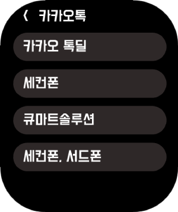
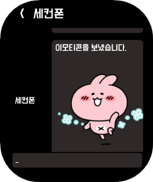
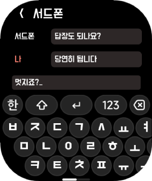
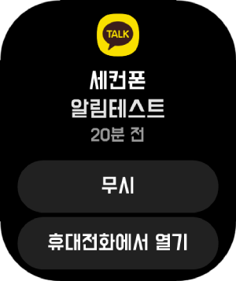
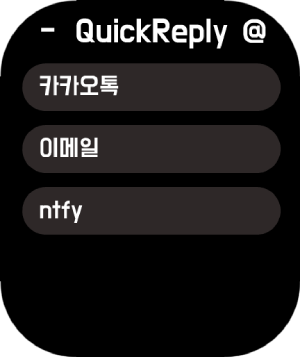
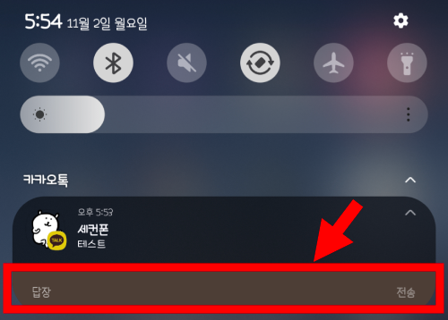

# 레드미워치 QuickReply
  

###
###
## 0. 들어가기에 앞서
- 해당 워치앱은 안드로이드용 MiFaceDown과 함께 사용해야 정상적인 사용이 가능합니다.

###
###
## 1. 앱 설치방법
### 1.1. [[다운로드]](https://raw.githubusercontent.com/maga32/mi-facedown-files/main/latest.apk) <= 버튼을 눌러 MiFaceDown 안드로이드용 apk앱을 설치해주세요.

### 1.2. 내정보 탭에서 워치 연동 후 [Face 탭 - 개발자서버 - 자신의 모델] 선택후 앱을 누르면 다운로드 후 설치됩니다.

###
###
## 2. 사용방법
### 2.1. 워치에 온 알림에서 '휴대전화에서 열기'를 누르거나 QuickReply앱을 직접 엽니다.

### 2.2. 목록중 확인하고싶은 앱을 선택합니다. 선택시 세부 목록을 선택할 수 있습니다.

- 앱목록은 워치에 알림이 오는경우 자동 갱신됩니다.

 

### 2.3. 내용 확인 및 답장이 가능합니다.

- 휴대폰 알림창에서 바로 답장이 가능한 앱만 지원합니다.

 

### 2.4. 추가로 간단한 첨부이미지 확인도 지원합니다.

###
###
## 3. 앱 삭제방법
### 3.1. 워치내에서 앱삭제를 제공하는 경우 꾹 눌러 삭제 가능합니다.
### 3.2. 워치내에서 삭제가 불가능한 모델은 [내정보 탭 - 연결기기작업 - 퀵앱선택]을 누르면 삭제 가능합니다.

###
###
## 4. 기타정보
- 위 앱은 샤오미 vela 프레임워크로 개발되었습니다 : https://iot.mi.com/vela/quickapp
